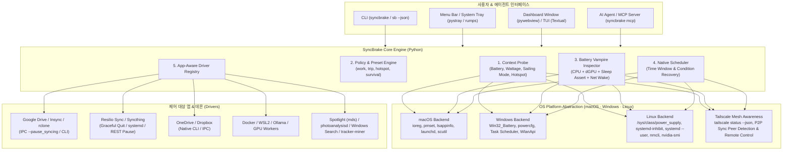

# SyncBrake (`syncbrake` / `sb`) — 설계 및 아키텍처 문서 (Planning & Design Spec)

> **"Put the brakes on background sync & battery drain — without freezing your filesystem."**  
> 출장·이동·테더링 환경에서 **macOS · Windows · Linux** (및 Tailscale로 묶인 멀티 노드 환경)의 배터리 및 핫스팟 데이터를 지키는 **앱 인지형(App-Aware) 동기화·백그라운드 제어기 & AI 에이전트 친화적 CLI/트레이 도구**

- **GitHub Repository**: [`https://github.com/z0nam/syncbrake`](https://github.com/z0nam/syncbrake)
- **Local Path**: `~/dev/syncbrake`
- **Primary CLI**: `syncbrake` (단축 별칭: `sb`)
- **Target OS**: **macOS** (Intel & Apple Silicon) / **Windows** 10 & 11 / **Linux** (Ubuntu/Debian/Arch/Fedora, Desktop & Headless Server)
- **Tailnet Integration**: Tailscale (`tailscale status --json`) 연동으로 내 테일넷 내 맥·윈도우·리눅스 피어 간 P2P 동기화 트래픽 감지 및 원격 노드 제어(`sb fleet`) 지원
- **Tech Stack**: Python 3.11+ (`uv` 기반 패키징) + Cross-platform System Tray & Window UI (`pystray` + `pywebview` / `Textual` TUI)

---

## 1. 배경 및 해결하려는 핵심 문제 (Problem Statement)

외근·출장 중 배터리나 보조배터리(PD Power Bank), 스마트폰 핫스팟으로 노트북을 구동할 때 기존 도구들은 다음과 같은 치명적인 한계를 가진다.

### 1.1 기존 접근법의 3대 한계
1. **무차별 `SIGSTOP` 동결기의 파일시스템 먹통 문제 (`App Tamer`, `OpenTamer`, `Wintertime` 등)**
   - 포커스를 잃은 프로세스에 강제로 `SIGSTOP`(`kill -STOP`)이나 스레드 일시중지를 걸면, macOS `FileProvider`(`Google Drive`, `OneDrive`, `Dropbox`)나 가상 볼륨 데몬이 응답 불능 상태가 되어 **Finder와 터미널(`ls`, `cd`) 전체가 멈추는(Beachball) 현상**이 발생한다.
   - 반드시 앱 고유의 **네이티브 IPC 명령(예: Google Drive `--pause_syncing`)**이나 안전한 라이프사이클 제어를 사용해야 한다.
2. **네트워크 차단기의 재시도 폭주 역설 (`TripMode`, 방화벽 차단 등)**
   - 핫스팟 환경에서 동기화 앱의 소켓만 방화벽으로 막으면, 앱은 오프라인 상태로 전환하는 대신 **수십 개의 `SYN_SENT` 재연결 루프와 로컬 디스크 변경 스캔을 무한 반복**하며 오히려 CPU와 배터리를 더 소모한다.
3. **보조배터리(PD Power Bank) & 80% 충전 제한(Sailing Mode) 판별 불가**
   - **보조배터리 역설**: 보조배터리나 기차/비행기 좌석의 저출력 포트(8W~30W)를 연결하면 OS는 무조건 `AC Power(전원 어댑터 연결됨)`로 인식하여 Spotlight 인덱싱, 사진 분석(`photoanalysisd`), 클라우드 동기화를 풀가동한다.
   - **80% 충전 제한 오탐(False Positive)**: 반대로 사용자가 배터리 수명 보호를 위해 80% 충전 제한(AlDente, `bclm`, 제조사 배터리 보호 등)을 걸어둔 경우, 배터리 잔량이 80% 이상(예: 90%)일 때 SMC가 의도적으로 어댑터 입력을 5V(8W)로 낮추고 `AC attached; not charging` 상태로 방전(Sailing)시킨다. 단순 방전 전류(`Amperage < 0`)만 보면 콘센트에 꽂혀 있는데도 보조배터리로 오판하게 된다.

---

## 2. 핵심 설계 원칙 (Core Principles)

1. **지능연결성 (AI-Agent First CLI & MCP)**
   - 인간 사용자뿐만 아니라 Claude Code, Codex, Antigravity 등 AI 코딩 에이전트가 즉시 호출·파싱할 수 있도록 모든 명령에 `--json` 구조화 출력, 명확한 Exit Code, 내장 MCP 서버(`syncbrake mcp`) 및 에이전트 스킬 명세를 제공한다.
2. **앱 인지형 안전 일시정지 (App-Aware Safe Pause)**
   - 가상 파일시스템 마운트는 유지하되 동기화 엔진만 멈추는 앱별 전용 드라이버(Driver) 아키텍처를 채택한다.
3. **폴링 없는 네이티브 스케줄링 (Zero-Polling Scheduled Recovery)**
   - 예약 복구(예: `16:00~24:00 일시정지 후 24:00 이후 온라인일 때 자동 재개`)를 위해 상주 데몬이 매초 루프를 도는 대신, macOS `launchd` (`StartCalendarInterval` + `WatchPaths`) 및 Windows `Task Scheduler`에 이벤트를 위임하여 슬립/웨이크 후에도 배터리 소모 0%로 동작한다.
4. **유연한 UI 모드 (Menu Bar / Tray + Window + TUI)**
   - 상단 메뉴바(macOS) / 시스템 트레이(Windows)에 등록해 원클릭으로 제어하거나, 독립 대시보드 창(`syncbrake ui`) 또는 터미널 UI(`syncbrake tui`)로 띄워 쓸 수 있다.

---

## 3. 시스템 아키텍처 (System Architecture)



---

## 4. 5대 핵심 모듈 상세 설계

### 4.1 모듈 1: 스마트 전원·상황 감지 (`syncbrake.probe`)

단순 `AC vs Battery` 이분법을 넘어 **macOS · Windows · Linux** 3대 OS의 실제 물리적 전력 흐름과 네트워크(핫스팟 및 Tailscale 터널) 환경을 판별한다.

| 감지 항목 | macOS 구현 방식 | Windows 구현 방식 | Linux 구현 방식 | 판별 로직 |
| :--- | :--- | :--- | :--- | :--- |
| **실시간 배터리 충·방전 전력(W)** | `ioreg -rn AppleSmartBattery` (`Voltage × Amperage`) | WMI `BatteryStatus` (`Voltage`, `DischargeRate`, `ChargeRate`) | `/sys/class/power_supply/BAT*` (`power_now` 또는 `voltage_now × current_now`) / `upower` | 순방전량(`Net Watts`) 및 예상 잔여 시간 계산 |
| **어댑터 협상 출력(W)** | `AppleRawAdapterDetails` (`Watts`, `AdapterVoltage`, `Current`) | PD Controller / WMI PowerSupply | `/sys/class/power_supply/ucsi*` 또는 `AC/online` + Type-C PD sysfs | 저출력 포트(`8W~30W`) 여부 감지 |
| **80% 충전 제한 (Sailing Mode) 구분** | `UISoc >= charge_limit (기본 80%)` + `ExternalConnected=Yes` + `IsCharging=No` | OEM Battery Charge Threshold + `ACLineStatus=1` | `/sys/class/power_supply/BAT*/charge_control_end_threshold` (예: `80`) + `status=Not charging` | **`SOC >= 80%`에서 비충전 방전 중이면 정상 콘센트(Sailing Mode)로 판정**하여 오작동 방지 |
| **보조배터리 / 저출력 어댑터 판정** | `SOC < 80%` 인데 `AdapterWatts < 45W` 또는 `NetAmperage < 0` | `SOC < 80%` 인데 `DischargeRate > 0` on AC | `SOC < threshold` 인데 `AC/online=1` 이면서 `status=Discharging` | 또는 사용자가 수동으로 `sb powerbank on` 토글 시 강제 활성 |
| **핫스팟 / 종량제 네트워크 감지** | `ipconfig` / `scutil --nwi` (`172.20.10.x` iPhone 핫스팟, Wi-Fi Low Data Mode) | `Windows.Networking.Connectivity` (`NetworkCostType == Variable/Fixed`) | `nmcli -t -f GENERAL.METERED dev show` (`yes`/`guessed-yes`) 또는 `172.20.10.x` | 테더링 연결 시 즉시 `hotspot` 정책 트리거 가능 |
| **Tailscale 피어 트래픽 감지** | `tailscale status --json` + `lsof` (`utun*` / `100.x.y.z`) | `tailscale status --json` + `Get-NetTCPConnection` | `tailscale status --json` + `ss -tupn` (`tailscale0`) | 핫스팟/배터리 상태에서 Tailscale을 타고 다른 윈/맥/리눅스 노드로 흐르는 P2P 동기화(Resilio, Syncthing, SMB/NFS 등) 즉시 식별 |

### 4.2 모듈 2: 앱 인지형 안전 드라이버 (`syncbrake.drivers`)

Finder, 탐색기, Linux 파일 매니저 프리징을 절대 유발하지 않는 앱별 맞춤 제어 드라이버를 제공한다.

| 드라이버 ID | 대상 앱 (OS) | 일시정지 (`pause`) 동작 | 재개 (`resume`) 동작 | 비고 |
| :--- | :--- | :--- | :--- | :--- |
| `gdrive` | **Google Drive** (macOS/Win) | `Google Drive --pause_syncing` IPC | `Google Drive --resume_syncing` (꺼져 있으면 기동 후 전송) | CloudStorage 마운트 유지, CPU 즉시 0% |
| `insync` / `rclone` | **Insync / rclone** (Linux/macOS/Win) | `insync pause_syncing` / `rclone rc core/bwlimit rate=off` | `insync resume_syncing` / `rclone rc core/bwlimit rate=off` 해제 | Linux 데스크톱/서버 구글 드라이브 클라이언트 지원 |
| `resilio` | **Resilio Sync** (macOS/Win/Linux) | `SIGTERM` 정상 종료 또는 `systemctl --user stop resilio-sync` | 백그라운드 재실행 (`open -g -a` / `Start-Process` / `systemctl --user start`) | Tailscale 경유 P2P 소켓(`10241`)까지 완전히 닫음 |
| `onedrive` | **OneDrive** (macOS/Win/Linux) | `/pause` 플래그 또는 `systemctl --user stop onedrive` | `/background` 기동 또는 `systemctl --user start onedrive` | 3대 OS 공통 지원 |
| `dropbox` | **Dropbox** (macOS/Win/Linux) | `dropbox stop` / IPC 일시정지 | `dropbox start` / 백그라운드 재기동 | |
| `syncthing` | **Syncthing** (macOS/Win/Linux) | REST API `POST /rest/system/pause` (특정 Tailscale 피어만 일시정지도 가능) | REST API `POST /rest/system/resume` | |
| `ollama` | **Ollama (Local LLM)** (3대 OS) | 실행 중인 모델 언로드 (`ollama stop`) 및 유휴화 | 요청 시 자동 로드 또는 서비스 재시작 | VRAM 및 GPU 유휴 전력 확보 |
| `docker` | **Docker / OrbStack / WSL2** | 비필수 컨테이너 pause 또는 `orb stop` / `wsl --shutdown` | 서비스 재기동 | 선택적(Opt-in) 드라이버 |
| `sys_index` | **OS 백그라운드 인덱서** | macOS `lowpowermode 1` / Win Search / Linux `tracker3 daemon -t` & `powerprofilesctl set power-saver` | 원래 전원 프로필 및 인덱서 복원 | |

### 4.3 모듈 3: 배터리 상위 소모 앱 인스펙터 & 선택 제어 (`syncbrake.top`)

현재 배터리를 갉아먹는 주범을 한눈에 보여주고 화이트리스트(필수 앱)를 제외한 앱을 골라 끄거나 일시정지한다.

- **배터리 영향도 점수 (Drain Score) 산출 공식**:
  $$\text{DrainScore} = (\text{CPU\%} \times 1.0) + (\text{SleepAssertion} \times 25) + (\text{dGPU Active} \times 30) + (\text{NetWakeups\_norm} \times 10)$$
  - **Sleep Assertion 감점**: `pmset -g assertions` (macOS) 또는 `powercfg /requests` (Windows)에서 `NoIdleSleepAssertion` / `PreventUserIdleSystemSleep`을 걸고 있는 앱(예: 백그라운드에 방치된 ChatGPT 데스크톱 앱, Parsec 등)을 즉시 상위에 노출.
  - **외장 GPU(dGPU) 유발 감점**: 인텔 맥북 프로나 게이밍 노트북에서 외장 GPU를 깨워 15~30W를 더 쓰게 만드는 프로세스 표시.
- **화이트리스트 보호 (`protected_apps`)**:
  - 기본 보호 목록: `Slack`, `Google Chrome`, `Claude`, `Ghostty`, `Terminal`, `iTerm2`, `Windows Terminal`, `WezTerm` (설정 파일에서 자유롭게 추가/제거 가능)
- **액션 모드**:
  - 드라이버가 있는 앱은 **`Pause (안전 일시정지)`** 우선 실행
  - 일반 GUI 앱(Parsec, Keynote, Skim, monday, 미사용 IDE 등)은 **`Quit (정상 종료)`** 실행

### 4.4 모듈 4: 상황별 정책 프리셋 (`syncbrake.presets`)

복잡한 옵션 없이 상황 이름 하나로 여러 드라이버와 OS 전원 옵션을 묶어서 실행한다.

| 프리셋 이름 | 설명 | 수행 동작 요약 |
| :--- | :--- | :--- |
| **`work`** *(기본/복구)* | 콘센트 연결 평상시 업무 모드 | 모든 클라우드 동기화 재개(`resume`), OS 저전력 모드 해제 |
| **`trip`** *(출장/이동)* | 보조배터리·이동 중 작업 모드 | `gdrive`, `resilio`, `onedrive`, `dropbox` 일시정지 + 원격 앱(Parsec, Synergy 등) 종료 + OS 저전력 모드 ON |
| **`hotspot`** *(테더링)* | 스마트폰 핫스팟 연결 모드 | 모든 P2P/클라우드 동기화 일시정지 + 대용량 백그라운드 업데이터(`GoogleUpdater`, `ShipIt` 등) 억제 |
| **`survival`** *(초절전)* | 배터리 20% 이하 비상 모드 | 화이트리스트(`Slack`, `Chrome`, `Claude`, `Terminal`) 외 모든 백그라운드/GUI 앱 정리 + 화면 절전 타이머 단축 |

### 4.5 모듈 5: 시간·조건 기반 자동 복구 스케줄러 (`syncbrake.scheduler`)

사용자가 일시정지해 두고 잊어버려도 지정된 시간·조건이 충족되면 알아서 동기화를 복구한다.

- **지원 조건 조합 (Composable Conditions)**:
  1. **시간 구간 (`--from 16:00 --until 24:00` 또는 `--until 24:00`)**:
     - 시작 시각이 미래면 시작 시각까지 대기 후 일시정지, 종료 시각 이후 복구 평가 시작
  2. **네트워크 조건 (`--when-online`, `--when-not-hotspot`)**:
     - 지정 시각이 지났더라도 오프라인이거나 핫스팟이면 대기했다가, 일반 Wi-Fi/이더넷 온라인 연결이 확인되는 순간 복구
  3. **전원 조건 (`--when-ac`, `--min-watts 45`)**:
     - 실제 충전 가능한 어댑터가 연결되었을 때 복구 (보조배터리 제외 옵션 가능)
- **OS 네이티브 등록**:
  - **macOS**: `~/Library/LaunchAgents/com.z0nam.syncbrake.schedule.plist` 생성 (`StartCalendarInterval` + `WatchPaths: /Library/Preferences/SystemConfiguration` + `StartInterval`). 복구 완료 시 스스로 `bootout` 및 `.plist` 삭제.
  - **Windows**: `schtasks` / Task Scheduler API를 통해 Time Trigger + Network State Change Event(`Microsoft-Windows-NetworkProfile/Operational` Event ID 10000) 등록 후 완료 시 자동 삭제.
  - **Linux**: `systemd --user` 타이머(`~/.config/systemd/user/syncbrake-resume.timer` & `.service`) + NetworkManager dispatcher 연동으로 등록 후 복구 완료 시 `systemctl --user disable --now` 자동 정리.

### 4.6 보너스 모듈: Tailscale 멀티 노드 연동 (`syncbrake.tailnet`)

동일한 Tailscale 테일넷에 물려 있는 **Windows · macOS · Linux** 머신들을 통합 인지한다.

- **출장 중 테일넷 피어 동기화 폭주 차단**:
  - 노트북이 핫스팟/배터리 상태로 전환되면, 현재 Tailscale 인터페이스(`utun*` / `tailscale0` / `100.x.y.z`)를 통해 집/연구실의 Linux 서버나 Windows 데스크톱과 통신 중인 백그라운드 프로세스(Resilio Sync `10241`, Syncthing `22000`, 원격 데스크톱 Parsec 등)를 정확히 집어내어 일시정지한다.
- **`sb fleet` (테일넷 전체 노드 상태 조회 및 원격 제어)**:
  - `tailscale status --json`으로 온라인 피어(Win/Mac/Linux)를 찾고, SSH/Tailscale을 통해 각 노드의 `sb status --json`을 수집하거나 특정 원격 노드에서도 동기화/무거운 작업을 잠시 멈추게(`sb --host <node> pause`) 명령할 수 있다.

---

## 5. CLI 명령어 설계 (`syncbrake` / `sb`)

직관적이고 타이핑이 짧으며, 모든 명령은 `--json` 플래그를 붙여 AI 에이전트가 파싱할 수 있다.

```bash
# 1. 현재 배터리·전원(W, 80% 제한 여부)·동기화 상태·상위 소모 앱 요약
sb status
sb status --json

# 2. 수동 일시정지 & 시간/조건부 자동 복구 예약
sb pause                                      # 모든 동기화 앱 즉시 일시정지
sb pause gdrive resilio                       # 특정 앱만 일시정지
sb pause --until 24:00 --when-online          # 지금 일시정지하고, 자정 이후 온라인일 때 자동 재개
sb pause --from 16:00 --until 24:00 --when-online  # 16시~24시 사이에만 일시정지, 24시 이후 온라인 시 재개

# 3. 즉시 수동 재개 (예약된 스케줄도 함께 취소)
sb resume
sb resume gdrive

# 4. 상황별 프리셋 적용
sb preset trip                                # 출장 모드 (동기화 정지 + 원격앱 종료 + 저전력)
sb preset hotspot                             # 핫스팟 모드
sb preset work                                # 평상시 업무 모드로 전체 복구
sb preset list

# 5. 배터리 많이 쓰는 상위 앱 조회 및 선택 정리 (화이트리스트 자동 보호)
sb top                                        # 상위 소모 앱 테이블 + Sleep 방해 앱 표시
sb top --interactive                          # 체크박스로 골라서 바로 Pause / Quit
sb trim --auto                                # 화이트리스트 외 추천 대상 일괄 Pause / Quit (dry-run: --dry-run)

# 6. 보조배터리(Power Bank) 수동/자동 모드 토글
sb powerbank on                               # 현재 AC로 잡혀 있어도 보조배터리 모드로 강제 간주

# 7. Tailscale 테일넷 멀티 노드(Win/Mac/Linux) 연동
sb fleet                                      # 테일넷 내 온라인 노드(맥/윈/리눅스) 및 P2P 트래픽 상태 조회
sb --host lab-linux status                    # 원격 리눅스/윈도우 노드의 syncbrake 상태 확인

# 8. UI 실행 (메뉴바/트레이 또는 독립 창 또는 TUI)
sb tray                                       # 메뉴바(macOS) / 시스템 트레이(Windows·Linux) 상주 실행
sb window                                     # 데스크톱 대시보드 창으로 띄우기
sb tui                                        # 터미널 내 대화형 TUI 실행 (SSH/리눅스 서버에서도 동일 UX)

# 9. AI 에이전트용 MCP 서버 실행
sb mcp
```

---

## 6. UI 설계 (Menu Bar / Tray & Window 모드)

사용자가 원하는 형태로 실행할 수 있도록 **트레이(Menu Bar) 모드**와 **독립 창(Window) 모드**를 모두 지원한다.

### 6.1 메뉴바 / 시스템 트레이 메뉴 구성 (`sb tray`)
```text
⚡ SyncBrake: ⏸ Paused (Until 24:00 Online)
──────────────────────────────────────────
🔋 Battery: 90% (-18.4W | ~3h 40m left)
🔌 Adapter: AC Attached (80% Limit Sailing)
📶 Network: iPhone Hotspot (Metered)
──────────────────────────────────────────
▶ Resume All Syncing Now
⏸ Pause All Syncing
⏰ Schedule Pause...
   ├─ Pause for 2 hours
   ├─ Pause until 24:00 (when online)
   └─ Pause 16:00 ~ 24:00 window
──────────────────────────────────────────
🎯 Presets
   ├─ ● Trip / Nomad Mode
   ├─ ○ Hotspot Saver Mode
   ├─ ○ Survival Mode
   └─ ○ Work (Normal) Mode
──────────────────────────────────────────
📦 Sync Services
   ├─ [Paused]  Google Drive
   └─ [Stopped] Resilio Sync
🔥 Top Battery Drainers (Click to Quit/Pause)
   ├─ ChatGPT.app (Sleep Blocker, 4.2%)  [Quit]
   ├─ Parsec.app (Idle Hook, 1.1%)       [Quit]
   └─ VS Code (Protected)                [🔒]
──────────────────────────────────────────
🪟 Open Dashboard Window...
⚙️ Preferences & Whitelist...
✖ Quit SyncBrake
```

### 6.2 대시보드 창 모드 (`sb window`) & TUI (`sb tui`)
- 메뉴바에 아이콘을 두기 싫을 때는 `sb window` (경량 네이티브 웹뷰 창) 또는 `sb tui` (터미널 대시보드)로 띄워 실시간 와트(W) 그래프, 프로세스별 Drain Score, 스케줄 타임라인, 화이트리스트/프리셋 편집을 한 화면에서 조작할 수 있다.

---

## 7. 디렉토리 구조 (Repository Layout)

```text
syncbrake/
├── pyproject.toml                 # uv 패키지 설정 및 CLI 엔트리포인트 (syncbrake, sb)
├── README.md                      # 프로젝트 소개 및 빠른 시작 가이드
├── DESIGN.md                      # 본 설계 문서
├── config.example.yaml            # 기본 화이트리스트, 프리셋, 80% 충전제한 임계치 설정 예시
└── src/
    └── syncbrake/
        ├── __init__.py
        ├── cli.py                 # Typer/Click 기반 CLI (syncbrake / sb, --json 지원)
        ├── config.py              # ~/.config/syncbrake/config.yaml 로더
        ├── probe/
        │   ├── __init__.py
        │   ├── base.py            # PowerState, NetworkState, TailscalePeer 데이터 모델
        │   ├── macos.py           # ioreg, pmset, scutil, 80% Sailing 감지
        │   ├── windows.py         # WMI, GetSystemPowerStatus, powercfg, Metered Wi-Fi 감지
        │   ├── linux.py           # /sys/class/power_supply, upower, systemd-inhibit, nmcli, nvidia-smi
        │   └── tailnet.py         # tailscale status --json 및 테일넷 P2P 소켓 매핑
        ├── drivers/
        │   ├── __init__.py
        │   ├── base.py            # SyncDriver 추상 클래스 (status, pause, resume, is_installed)
        │   ├── gdrive.py          # Google Drive (--pause_syncing / --resume_syncing)
        │   ├── insync_rclone.py   # Insync / rclone (Linux/Cross-platform Google Drive)
        │   ├── resilio.py         # Resilio Sync 제어 (macOS/Win/Linux systemd)
        │   ├── onedrive.py        # OneDrive 제어
        │   ├── dropbox.py         # Dropbox 제어
        │   └── daemons.py         # Ollama, Docker, 인덱서 제어
        ├── inspector/
        │   ├── __init__.py
        │   └── top.py             # 프로세스별 Drain Score 산출, Sleep Assertion 매핑, 화이트리스트 필터링
        ├── presets/
        │   ├── __init__.py
        │   └── engine.py          # work, trip, hotspot, survival 프리셋 실행기
        ├── scheduler/
        │   ├── __init__.py
        │   ├── macos_launchd.py   # launchd plist 생성/로드/자동 정리
        │   ├── win_schtasks.py    # Windows Task Scheduler 등록/정리
        │   └── linux_systemd.py   # systemd --user timer & NetworkManager dispatcher 등록/정리
        ├── ui/
        │   ├── tray.py            # 메뉴바 / 시스템 트레이 상주 UI
        │   ├── window.py          # 독립 창 대시보드 UI
        │   └── tui.py             # 터미널 대화형 TUI
        └── mcp/
            └── server.py          # AI 에이전트용 MCP 서버
```

---

## 8. 단계별 구현 로드맵 (Implementation Roadmap)

- **Milestone 1 (Core & CLI MVP — macOS 우선 동작)**
  - `uv` 프로젝트 초기화 및 `syncbrake` (`sb`) CLI 엔트리포인트 구축
  - `probe/macos.py`: 배터리 실측 와트(W), 어댑터 출력, 80% 충전 제한(Sailing Mode) 구분 로직 구현
  - `drivers/gdrive.py`, `drivers/resilio.py` 및 `scheduler/macos_launchd.py` 이식 (`sb status`, `sb pause --from 16:00 --until 24:00 --when-online`, `sb resume`)
  - `inspector/top.py`: CPU + `pmset assertions` 결합 상위 배터리 소모 앱 조회(`sb top`) 및 화이트리스트 보호 일괄 정리(`sb trim`)
- **Milestone 2 (Presets & Cross-Platform Windows Backend)**
  - `config.yaml` 기반 프리셋(`trip`, `hotspot`, `work`, `survival`) 및 화이트리스트 커스텀
  - `probe/windows.py`, `scheduler/win_schtasks.py`, `onedrive.py` 구현
- **Milestone 3 (Menu Bar / Tray & Dashboard Window UI)**
  - `sb tray` (macOS 메뉴바 & Windows 트레이 아이콘) 및 `sb window` / `sb tui` 구현
- **Milestone 4 (AI Agent Integration — MCP & Skill)**
  - `sb mcp` 서버 및 Claude Code / Antigravity `SKILL.md` 번들링 (`"출장 모드 켜줘"`, `"16시부터 자정까지 동기화 멈춰줘"` 자연어 제어)
